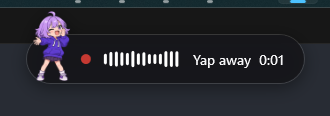
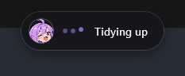
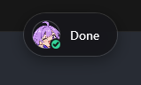
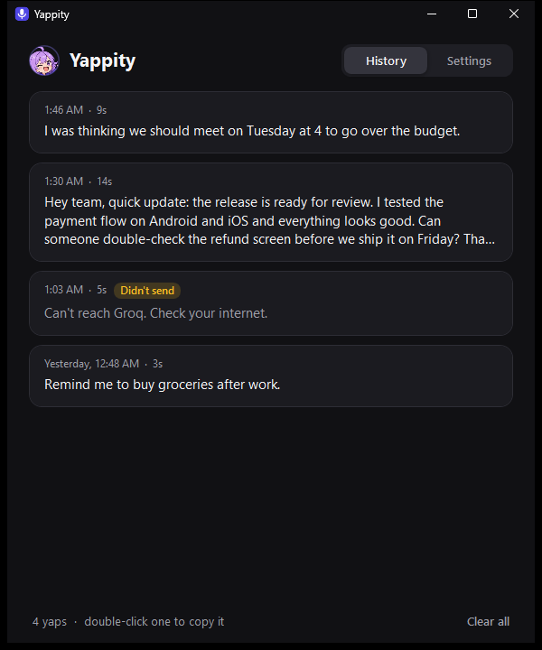
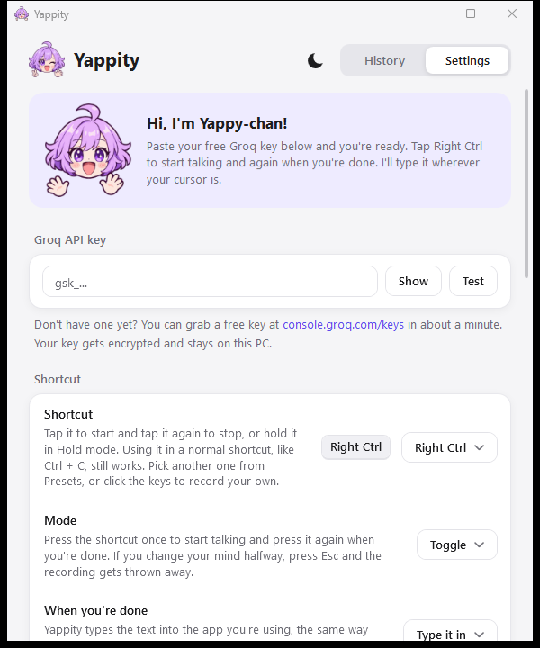
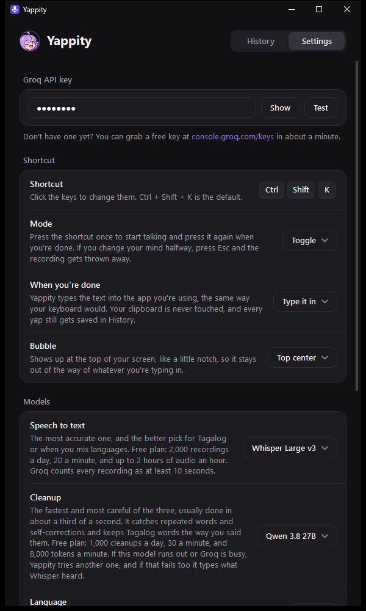
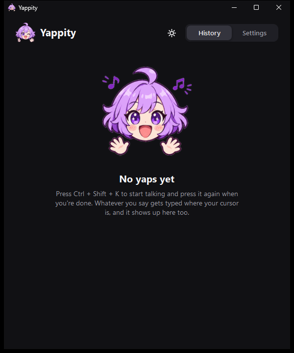

<p align="center">
  
</p>

<h1 align="center">Yappity</h1>

<p align="center">
  <b>Free voice typing for Windows.</b><br>
  Tap <kbd>Right Ctrl</kbd>, yap, tap it again. Whatever you said gets typed where your cursor is.
</p>

<p align="center">
  
  
  
  
  
</p>

<p align="center">
  <a href="https://apps.microsoft.com/detail/9N53CJD8P2B4"><b>Get Yappity on the Microsoft Store</b></a>
  &nbsp;|&nbsp;
  <a href="https://github.com/paulablaza/yappity/releases">Download the portable .exe</a>
  <br>
  <a href="https://yappity.pages.dev"><b>yappity.pages.dev</b></a> · Also on Android: <a href="https://github.com/paulablaza/yappity-mobile">Yappity for Android</a>
</p>

---

## Why I made this

I wanted something like Wispr Flow without paying for a subscription every month. The free and open
source ones I tried either run Whisper on your own PC, which gets slow fast if your PC isn't strong,
or they ship a whole browser engine just to show a settings window.

So Yappity does the heavy lifting on Groq instead. Groq gives everyone a free API key, and their
servers turn your voice into text in about a second. That means it's fast even on a cheap laptop,
and the app itself stays tiny. You bring your own free key and that's it, nothing to pay, nothing
to sign up for besides Groq.

---

## What it does

<table>
  <tr>
    <td align="center" width="25%"><br><b>You talk</b><br>Tap <kbd>Right Ctrl</kbd> and yap. Yappy-chan talks along with your voice.</td>
    <td align="center" width="25%"><br><b>She writes it down</b><br>Whisper Large v3 turns it into text, usually in about a second.</td>
    <td align="center" width="25%"><br><b>She tidies it up</b><br>The um, uh and you know get cleaned out. Your words stay yours.</td>
    <td align="center" width="25%"><br><b>Done</b><br>The text lands right where your cursor is, in any app.</td>
  </tr>
</table>

<p align="center">
  
  
  
</p>

While you talk, a little bubble shows up at the top of your screen with your voice level, a timer and
Yappy-chan. It never steals focus from what you're typing in, and clicks go right through it.

**The cleanup is careful on purpose.** It only removes filler words, stutters and false starts, and
fixes punctuation. If you say "at 3, no wait, at 4", you get "at 4". It never rewrites your
sentences, never answers a question you dictate, never translates, and never uses em dashes.

---

## Features

- **Free.** Runs on Groq's free plan. About 2,000 recordings a day per key.
- **Fast.** Usually about a second from when you stop talking to when the text shows up.
- **Tiny.** One `.exe` under 1 MB. Nothing to install, it uses the .NET that comes with Windows.
- **Light.** About 2 MB of memory in Task Manager while it waits in your tray.
- **Lands instantly.** The text gets pasted in one go, even after minutes of talking, and whatever you had copied before is put back right after. There's a typing mode for the rare app that blocks pasting.
- **Four styles.** **Raw** gives you exactly what Whisper heard. **Clean up** keeps your words in one block. **Clean up and format** turns a yapped list into dash lines and splits long yaps into paragraphs. **Organize** turns a 5 minute ramble into a clear message: every point as a full sentence on its own dash line, grouped by topic, repeats dropped. Your exact words always stay in History.
- **Taglish friendly.** An English + Tagalog mode keeps every word in the language you said it in.
- **Never loses a yap.** Every recording is saved. Play it, send it again, or drag it into any app or folder.
- **Your shortcut, your way.** <kbd>Right Ctrl</kbd> by default. Tap it to start and stop, or switch to Hold mode and hold it while you talk. Pick another one from the presets or record any keys you want. <kbd>Esc</kbd> cancels.
- **Long recordings.** Up to 30 minutes. Long ones get split at a pause and sent in parts.
- **Backup model.** If the cleanup model is busy or out of free requests, Yappity tries another one, then falls back to exactly what Whisper heard.
- **Light and dark mode,** with a one-click switch in the window.

---

## Screenshots

<p align="center">
  
  
</p>
<p align="center">
  
  
</p>

---

## Get started

1. Install Yappity from the [Microsoft Store](https://apps.microsoft.com/detail/9N53CJD8P2B4), or download
   the portable `Yappity.exe` from [Releases](../../releases).
2. If you use the standalone `.exe`, Windows might warn you because it isn't code signed yet.
   Click **More info**, then **Run anyway** if you trust this download. The source code is here to inspect.
3. Grab a free key at [console.groq.com/keys](https://console.groq.com/keys). It takes about a minute.
4. Paste the key in Settings and press **Test**.
5. Click into any text box, tap <kbd>Right Ctrl</kbd>, say something, and tap it again.

That's the whole setup. Yappity lives in your tray and in the Start menu, so search for "Yappity" any
time you want the window back. Turn on **Start with Windows** in Settings if you want it ready every time.

### Installed or portable, your pick

- **Installed:** press **Settings > Other > Install on this PC**. Yappity copies itself to your user
  folder, shows up in the Start menu and in Windows Settings > Apps, and you can uninstall it from
  there like any other app. No admin needed. From a terminal, `Yappity.exe --install` does the same.
- **Portable:** just run `Yappity.exe` from wherever you saved it. Want everything on a USB stick?
  Put an empty file called `Yappity.portable` next to the `.exe` and your settings, history and
  recordings stay in a `YappityData` folder right beside it.

---

## Settings

| Setting | What it does |
| :--- | :--- |
| Shortcut | <kbd>Right Ctrl</kbd> by default. Presets for Right Alt, Right Shift, Ctrl + Shift + K, Ctrl + Space, F9 and Pause, or record your own |
| Mode | **Toggle** (tap to start, tap to stop) or **Hold** (hold while you talk). Using Right Ctrl in a normal shortcut like Ctrl + C still works |
| When you're done | **Paste it** (default, your clipboard gets put back), **Type it in** like a keyboard, or **History only** |
| Bubble | Top center (default), any corner, or bottom center |
| Speech to text | Whisper Large v3 (most accurate) or Whisper Large v3 Turbo (a bit faster) |
| Cleanup | Qwen 3.8 27B (default), gpt-oss-120b, gpt-oss-20b, or off |
| Style | **Raw** (exactly what Whisper heard), **Clean up** (one block, the way you said it), **Clean up and format** (lists with dashes, short paragraphs) or **Organize** (a clear grouped message, every point a full sentence) |
| Language | Auto, **English + Tagalog** for Taglish, or one fixed language |
| Words to spell right | Names and slang Whisper keeps getting wrong, separated by commas |
| Keep recordings | 1, 3, 7 (default) or 30 days, or don't keep them. Failed ones always stay 30 days |
| Theme | Match Windows, light or dark |
| Start with Windows | Opens Yappity quietly in your tray when you sign in |

---

## Free tier limits

These are Groq's free limits per API key at the time of writing. Settings shows how many you have
left today after your first yap.

| Model | Used for | Free limit |
| :--- | :--- | :--- |
| `whisper-large-v3` and `whisper-large-v3-turbo` | Speech to text | 2,000 a day, 20 a minute, 2 hours of audio an hour |
| `qwen/qwen3.8-27b` | Cleanup (default) | 1,000 a day, 30 a minute, 8,000 tokens a minute |
| `openai/gpt-oss-120b` and `openai/gpt-oss-20b` | Cleanup | 1,000 a day, 30 a minute, 8,000 tokens a minute |

Groq counts every recording as at least 10 seconds. Each cleanup model has its own daily limit, so
with the backup model you get around 2,000 cleanups a day. Groq sets these numbers and can change
them, so check [console.groq.com/docs/rate-limits](https://console.groq.com/docs/rate-limits) if
something looks off.

---

## Performance

Measured on Windows 11 with `tools/benchmark.ps1`. "Task Manager" is the Memory column you see there.

| | Result |
| :--- | :--- |
| Download size | 616 KB, one file |
| Memory while idle in the tray | about 2 to 3 MB |
| Memory with the window open | about 24 MB, back to idle when you close it |
| Window opens in | under a second |
| Speech to text (9 second clip) | about 0.9 seconds on Groq |
| Cleanup | about 0.3 seconds with Qwen, about 0.8 with gpt-oss-120b |
| CPU while the bubble animates | a few percent of one core, nothing while idle |

---

## Privacy

Your audio goes from your PC straight to Groq and nowhere else. There's no account, no analytics and
no server of mine in between. Your Groq key is encrypted with Windows DPAPI, so only your Windows
account can read it. History and recordings stay on your PC in `%APPDATA%\Yappity`, and old
recordings get deleted on their own. The full version is in [PRIVACY.md](PRIVACY.md).

---

## Meet Yappy-chan

<p align="center">
  
  
  
</p>

Yappy-chan is the chibi who lives in Yappity. She's the app icon, she waves at you the first time you
open it, dances while your history is empty, and reacts in the bubble while you talk: holding the
mic, typing on her tiny laptop, sweeping up the um's with a magic wand, and winking with a thumbs up
when it's done. If something goes wrong she scratches her head, and if Whisper didn't hear anything
she dozes off.

---

## FAQ

**Windows Defender or SmartScreen warns me about it.**
Yappity isn't code signed yet, so Windows doesn't know it. It also listens for your shortcut in every
app, which is the same Windows feature some keyloggers use, so a few antivirus apps get nervous.
All of the code is in this repo, and you can build it yourself in one command (see below).

**It didn't type into an app.**
Windows blocks normal apps from typing into apps that run as administrator. Yappity tells you when
that happens, and the text is waiting in History. If an app ignores the paste, switch
**When you're done** to **Type it in** for that one.

**I talk in Taglish and Whisper translates some of it.**
Set **Language** to **English + Tagalog**. It tells Whisper to expect both and keep each word as you
said it.

**It says it didn't hear anything.**
Check that your mic is on and that Windows Settings > Privacy > Microphone allows desktop apps.

**I hit the free limit.**
The recording is saved in History. Send it again later, or switch the cleanup model in Settings,
since each model has its own daily limit.

---

## Build it yourself

You don't need Visual Studio or any SDK. Windows already comes with a C# compiler.

```powershell
git clone https://github.com/paulablaza/yappity
cd yappity
powershell -ExecutionPolicy Bypass -File build.ps1
```

That gives you `bin\Yappity.exe`. If you're an AI coding agent, or you're pointing one at this repo,
read [AGENTS.md](AGENTS.md) first. It has the build rules, where everything lives, and how to test
without a mic.

| File | What's in it |
| :--- | :--- |
| `src/App.cs` | Tray icon and the record, transcribe, clean up, type flow |
| `src/KeyboardHook.cs` | The global shortcut, toggle and hold modes, <kbd>Esc</kbd> to cancel |
| `src/Recorder.cs` | Mic recording at 16 kHz mono with the Windows waveIn API |
| `src/Groq.cs` | Whisper and cleanup requests, model list, free limits, the cleanup prompt |
| `src/Paster.cs` | Typing the text in, or pasting it |
| `src/Bubble.cs` | The floating bubble and Yappy-chan's animations in it |
| `src/MainWindow.cs`, `src/Kit.cs` | History and Settings window (WPF) |
| `src/Store.cs` | Settings, history, recordings and logs |
| `src/Installer.cs` | Install, uninstall and portable mode |
| `tools/make-art.py` | Turns the art in `design/yappy-chan` into the app images, icon and GIFs |
| `tools/benchmark.ps1` | The memory benchmark above |

---

## License

MIT. Use it, fork it, make your own version. If you make something cool with it, I'd love to see it.
