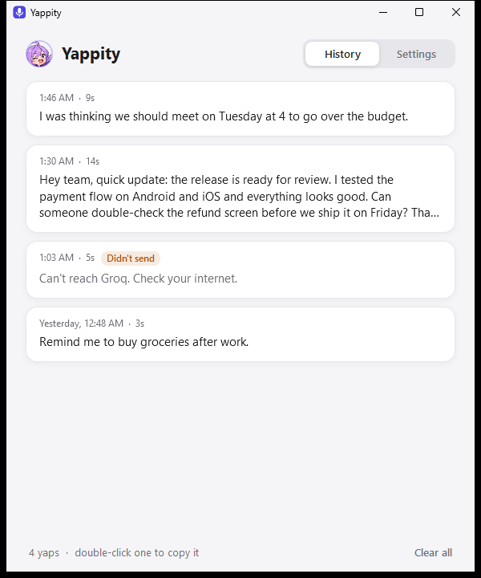
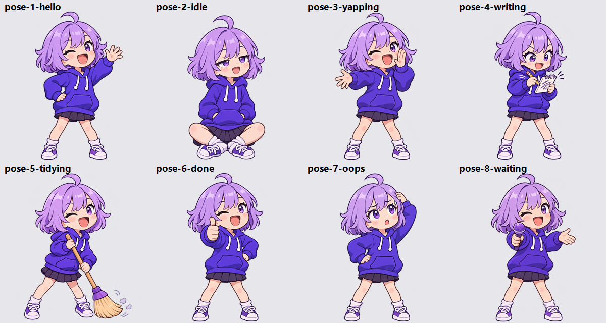

<p align="center">
  
</p>

<h1 align="center">Yappity</h1>

<p align="center">
  Press a shortcut, yap, press it again. Whatever you said gets typed where your cursor is.<br>
  Free voice typing for Windows, running on Groq's free API.
</p>

---

## Why this exists

I wanted something like Wispr Flow without paying for a subscription. The open source ones I found
either run Whisper on your own PC, which gets slow if your PC isn't strong, or ship a whole browser
engine just to show a settings window.

Yappity sends your audio to Groq instead, so it's fast even on a cheap laptop. You bring your own free
Groq key and that's it. The whole app is one small `.exe`, and while it waits in your tray it uses
about 1 MB of memory.

---

## How it works

<p align="center">
  
  
  
</p>

1. Press **Ctrl + Shift + K** anywhere and start talking. A little bubble with Chatter-Chan shows up
   at the top of your screen with your voice level and a timer.
2. Press **Ctrl + Shift + K** again when you're done. Press **Esc** instead if you want to throw it away.
3. **Whisper Large v3** turns your voice into text, usually in about a second.
4. **Qwen 3.8 27B** tidies it up. It takes out the um, uh, you know, repeated words and false starts,
   and fixes the punctuation. If you say "at 3, no wait, at 4", you get "at 4". It never rewrites
   your sentences, never answers questions you dictate, and never translates.
5. Yappity types the text into whatever app you're in, the same way your keyboard would, so your
   clipboard stays untouched.

Every yap also lands in **History**. Double-click one to copy it. If your internet dropped, the audio
is saved there too so you can retry it.

<p align="center">
  
  
</p>

---

## Setup

1. Download `Yappity.exe` from [Releases](../../releases) and run it.
   Windows will probably warn you that it doesn't recognize the app, because it isn't code signed yet.
   Click **More info**, then **Run anyway**.
2. Get a free key at [console.groq.com/keys](https://console.groq.com/keys) and paste it in Settings.
3. Click into any text box, press Ctrl + Shift + K and say something.

You don't need to install anything else. Yappity runs on the .NET Framework that already comes with
Windows 10 and 11.

<p align="center">
  
  
</p>

---

## Settings

| Setting | What it does |
| :--- | :--- |
| Shortcut | Click it and press any keys you want. Ctrl + Shift + K is the default |
| Mode | **Toggle** (press to start, press to stop) or **Hold** (hold while you talk) |
| When you're done | **Type it in** (default), **Paste it** with Ctrl+V, or **History only** |
| Bubble | Top center (default), any corner, or bottom center |
| Speech to text | Whisper Large v3 (most accurate) or Whisper Large v3 Turbo (a bit faster) |
| Cleanup | Qwen 3.8 27B (default), gpt-oss-120b, gpt-oss-20b, or off |
| Language | Auto, **English + Tagalog** for Taglish, or a fixed language |
| Words to spell right | Names and slang Whisper keeps getting wrong, separated by commas |
| Theme | Match Windows, light or dark |
| Start with Windows | Opens Yappity quietly in your tray when you sign in |

If the cleanup model hits its limit or Groq is busy, Yappity tries a second model, and if that fails
too it types exactly what Whisper heard. You never lose a yap.

Recordings can be up to 30 minutes long. Anything over 10 minutes gets split at a pause and sent to
Groq in parts, because Groq only takes files up to 25 MB.

Windows doesn't let normal apps type into apps running as admin. In those, Yappity tells you and
keeps the text in History.

---

## Free tier limits

These are Groq's free limits per API key, at the time of writing:

| Model | Used for | Free limit |
| :--- | :--- | :--- |
| `whisper-large-v3` / `whisper-large-v3-turbo` | Speech to text | 2,000 a day, 20 a minute, 2 hours of audio an hour |
| `qwen/qwen3.8-27b` | Cleanup | 1,000 a day, 30 a minute, 8,000 tokens a minute |
| `openai/gpt-oss-120b` / `openai/gpt-oss-20b` | Cleanup | 1,000 a day, 30 a minute, 8,000 tokens a minute |

Groq counts every recording as at least 10 seconds. Each cleanup model has its own daily limit, so
with the backup model you get around 2,000 cleanups a day. Settings shows how many you have left
today after your first yap.

*(Groq sets these limits and can change them. Check [console.groq.com/docs/rate-limits](https://console.groq.com/docs/rate-limits).)*

---

## Privacy

Your audio goes from your PC to Groq and nowhere else. Your key is encrypted with Windows DPAPI, so
only your Windows account can read it. History stays on your PC in `%APPDATA%\Yappity`.

---

## Meet Chatter-Chan

<p align="center">
  
</p>

She's the one waving at you on first launch, holding the mic when your history is empty, and
reacting in the bubble while you talk.

---

## Build it yourself

You don't need Visual Studio or any SDK. Windows already has a C# compiler.

```powershell
powershell -ExecutionPolicy Bypass -File build.ps1
```

That gives you `bin\Yappity.exe`.

| File | What's in it |
| :--- | :--- |
| `src/App.cs` | Tray icon and the record, transcribe, clean up, type flow |
| `src/KeyboardHook.cs` | The global shortcut, toggle and hold modes, Esc to cancel |
| `src/Recorder.cs` | Mic recording at 16 kHz mono using the Windows waveIn API |
| `src/Groq.cs` | Whisper and cleanup requests, model list and free limits |
| `src/Paster.cs` | Typing the text in, or pasting it |
| `src/Bubble.cs` | The floating bubble |
| `src/MainWindow.cs`, `src/Kit.cs` | History and Settings window (WPF) |
| `src/Store.cs` | Settings, history and logs |
| `tools/` | Scripts that make the mascot images and the GIF |

Commands for testing without a mic or hotkey:

```powershell
# Send a WAV file through Whisper and cleanup (uses GROQ_API_KEY or your saved key)
bin\Yappity.exe --test sample.wav result.txt

# Run each line of a text file through cleanup only
bin\Yappity.exe --clean-test lines.txt result.txt

# Record a few seconds from your mic
bin\Yappity.exe --record-test 3 mic.wav
```

Set `YAPPITY_HOME` if you want settings and history in a different folder.

---

## License

MIT
